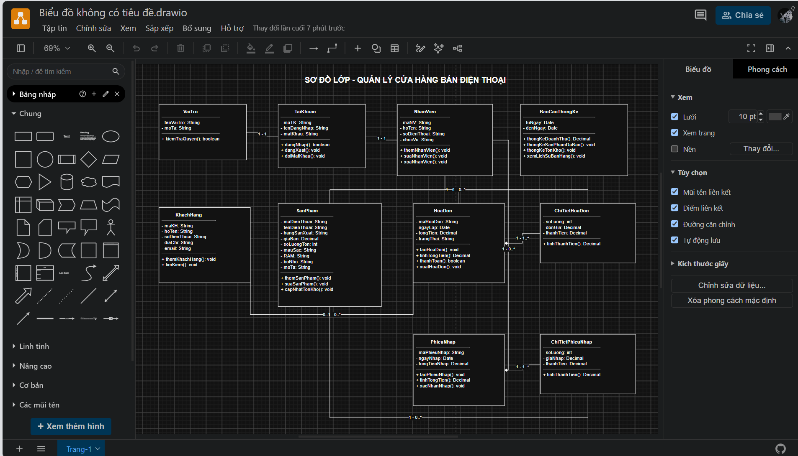

# PHẦN MỀM QUẢN LÝ CỬA HÀNG BÁN ĐIỆN THOẠI

## 1. Thông tin đề tài

- **Học phần:** Phân tích và thiết kế hướng đối tượng (OOAD)
- **Nhóm:** 14
- **Đề tài:** Phần mềm quản lý cửa hàng bán điện thoại

### Thành viên nhóm

- Nguyễn Nhật Dũng
- Phan Thành Công

## 2. Phát biểu bài toán

Việc quản lý cửa hàng bán điện thoại bằng phương pháp thủ công gây khó khăn trong quá trình quản lý sản phẩm, khách hàng, nhân viên, nhập hàng, bán hàng và thống kê doanh thu. Khi số lượng sản phẩm và giao dịch tăng lên, việc tìm kiếm thông tin, kiểm tra tồn kho, lập hóa đơn và tổng hợp doanh thu có thể mất nhiều thời gian và dễ xảy ra sai sót.

Vì vậy, nhóm xây dựng phần mềm quản lý cửa hàng bán điện thoại nhằm hỗ trợ quản lý dữ liệu tập trung, nâng cao hiệu quả làm việc, giảm sai sót và hỗ trợ theo dõi tình hình kinh doanh.

## 3. Mục tiêu hệ thống

- Quản lý thông tin điện thoại và số lượng tồn kho.
- Quản lý thông tin khách hàng.
- Quản lý tài khoản và thông tin nhân viên.
- Hỗ trợ quản lý hoạt động nhập hàng và bán hàng.
- Quản lý hóa đơn giao dịch.
- Hỗ trợ thống kê doanh thu và tình hình kinh doanh.
- Phân quyền sử dụng theo vai trò của người dùng.

## 4. Đối tượng sử dụng

### 4.1. Quản lý

- Quản lý sản phẩm.
- Quản lý nhân viên.
- Quản lý thông tin khách hàng.
- Theo dõi hoạt động nhập hàng và bán hàng.
- Xem thống kê, báo cáo doanh thu.

### 4.2. Nhân viên

- Tra cứu và cập nhật sản phẩm theo quyền được cấp.
- Quản lý thông tin khách hàng.
- Thực hiện các nghiệp vụ bán hàng.
- Hỗ trợ nghiệp vụ nhập hàng theo quyền được cấp.

## 5. Các chức năng chính

### 5.1. Quản lý sản phẩm

- Thêm sản phẩm.
- Sửa thông tin sản phẩm.
- Xóa sản phẩm khi đáp ứng điều kiện nghiệp vụ.
- Hiển thị danh sách sản phẩm.
- Tìm kiếm sản phẩm.
- Cập nhật số lượng tồn kho.

Thông tin sản phẩm gồm: mã điện thoại, tên điện thoại, hãng sản xuất, giá bán, số lượng, màu sắc, RAM, bộ nhớ và mô tả.

### 5.2. Quản lý khách hàng

- Thêm khách hàng.
- Sửa thông tin khách hàng.
- Xóa khách hàng khi đáp ứng điều kiện nghiệp vụ.
- Tìm kiếm khách hàng.
- Xem danh sách khách hàng.

Thông tin khách hàng gồm: mã khách hàng, họ tên, số điện thoại, địa chỉ và email.

### 5.3. Quản lý nhân viên

- Thêm nhân viên.
- Cập nhật thông tin nhân viên.
- Xóa nhân viên khi đáp ứng điều kiện nghiệp vụ.
- Tra cứu thông tin nhân viên.

### 5.4. Quản lý nhập hàng và bán hàng

- Ghi nhận thông tin nhập hàng.
- Ghi nhận giao dịch bán hàng.
- Lập và quản lý hóa đơn.
- Cập nhật số lượng tồn kho theo giao dịch.

### 5.5. Thống kê và báo cáo

- Thống kê doanh thu.
- Theo dõi tình hình nhập hàng và bán hàng.
- Tra cứu dữ liệu phục vụ quản lý kinh doanh.
## 6. Sơ đồ Class Diagram

## 7. Công nghệ và công cụ

- **Phân tích, thiết kế:** UML.
- **Công cụ vẽ sơ đồ:** StarUML hoặc draw.io.
- **Quản lý mã nguồn:** Git và GitHub.

## 8. Kết quả mong đợi

Phần mềm giúp cửa hàng quản lý sản phẩm, khách hàng, nhân viên, nhập hàng và bán hàng có hệ thống hơn; hỗ trợ tra cứu dữ liệu nhanh chóng, theo dõi tồn kho và tổng hợp doanh thu thuận tiện.

